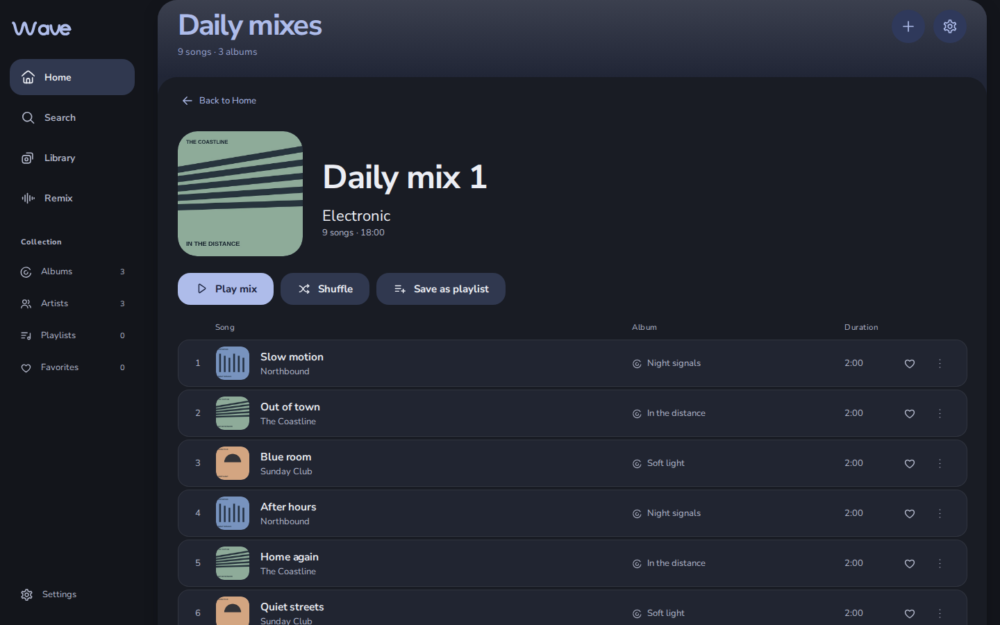
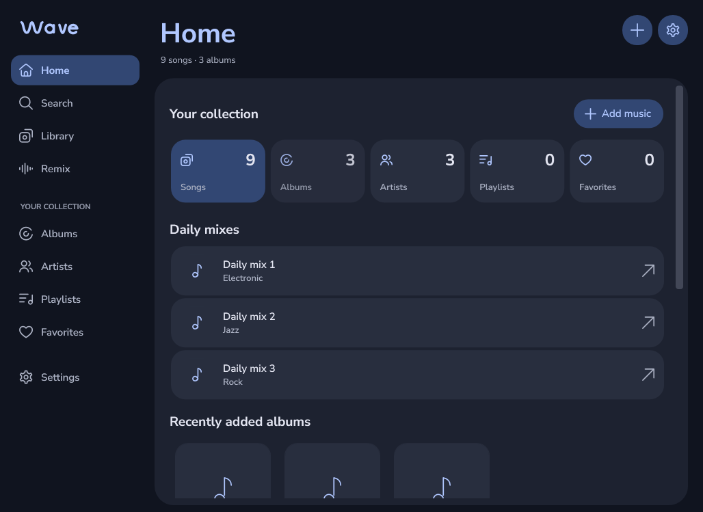
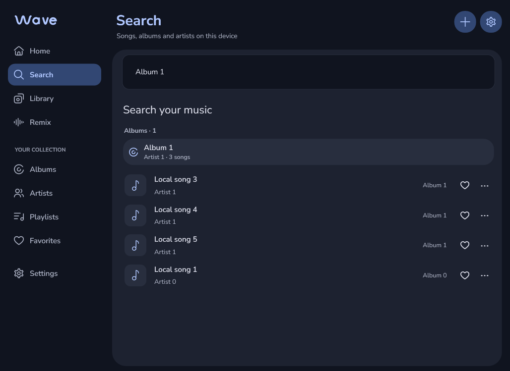

<p align="center"></p>
<p align="center"><strong>Your music, in your own space.</strong></p>
<p align="center">
  <a href="https://wave.jaime-gaming.com"><strong>Open Wave</strong></a> ·
  <a href="https://github.com/jaime-gaming/Wave/releases">Downloads</a> ·
  <a href="docs/README.es.md">Español</a> ·
  <a href="docs/WHY_WAVE.md">Why Wave</a> ·
  <a href="docs/media/wave-promo.mp4">Introduction film</a> ·
  <a href="docs/README.md">Documentation</a>
</p>


Wave is a music player for the files you already have. Organize a library, make playlists,
follow lyrics and rediscover your listening with Remix. Start in a browser, or explore the
independent native apps for Windows, Android and iOS.

**Looking at the source?** This branch describes Wave **0.3.0 in development**. The live website
and public downloads may be older and may not contain every feature shown here. Check the
[releases](https://github.com/jaime-gaming/Wave/releases) for what is actually available.

## Get started

### Listen on the web

1. Open [wave.jaime-gaming.com](https://wave.jaime-gaming.com) in a modern browser.
2. Choose **Add music** and select your audio files. Folder access depends on your browser.
3. Pick a song and press play. You can also install the web app from a supported browser.

Your local files are not uploaded for playback. Keep the originals: clearing browser data or
uninstalling an app can remove Wave's stored copies. Browser storage and codec support vary.

### Install a native app

| Platform    | How to start                                                                                                                        | Important to know                                                                                                                                                                                                                  |
| ----------- | ----------------------------------------------------------------------------------------------------------------------------------- | ---------------------------------------------------------------------------------------------------------------------------------------------------------------------------------------------------------------------------------- |
| **Android** | Download the APK from [Releases](https://github.com/jaime-gaming/Wave/releases), open it and follow Android's installation prompts. | In-place updates require the same signing key. Check the release and your device before installing.                                                                                                                                |
| **Windows** | Check [Releases](https://github.com/jaime-gaming/Wave/releases) for a Windows asset and its instructions.                           | The latest public 0.2.2 release has no Windows asset; an older unsigned ZIP exists. Unsigned builds can trigger a security warning. Future builds are configured as a standalone `Wave.exe`, but configuration is not publication. |
| **iOS**     | Build the [SwiftUI app for iPhone and iPad](platforms/ios/README.md) from source using Xcode 26.                                    | Source and simulator builds only for now: no signed IPA and no App Store upload. A physical device needs separate signing.                                                                                                         |

Each app has its **own library**. Features and file handling differ; installing another app does
not automatically move your music. See [platform support and build steps](docs/PLATFORMS.md).

## What you can do

- **Build your collection:** import supported local files, browse songs, albums and artists,
  make playlists and mark favourites. Web imports support MP3, WAV, M4A, OGG and FLAC up to
  200 MB per file; actual playback depends on your browser and codecs.
- **Enjoy your music:** use the queue, local Daily Mixes, listening recaps and Mix transitions.
  The implementations vary by platform and Mix quality depends on the recordings and device.
- **Follow the words:** import lyrics; timed LRC follows playback. Online lyric lookup is optional
  and sends song metadata to the selected provider.
- **Explore YouTube on the web:** search or add a public link and play through YouTube's embedded
  player. It needs a connection and is subject to provider and browser restrictions; Wave does not
  download YouTube audio. Native Android and iOS offer a separate preview, not web queue parity.
- **Bring playlists over on the web:** paste a public Spotify, YouTube or Deezer link, a text
  list, or choose an exported M3U/CSV file. Review and correct YouTube matches before creating a
  playlist. Private or partially visible lists may need an export; matches and playback are not
  guaranteed. No audio is downloaded by migration.
- **Link devices and back up on the web:** pairing and transfer are explicit. Password-encrypted,
  device-signed backups restore only into an empty web library; independently check the device
  fingerprint and keep your password and original files safe. Native apps do not yet support the
  web backup format. [Backup details](docs/BACKUP_FORMAT.md).

There is no Wave account or automatic cloud library sync. Optional lookups and YouTube contact
third parties; see [Privacy and data flow](PRIVACY.md) before using them.

## Where it runs

Wave has four independently built clients. A yes means the feature exists in the current source;
its behaviour and depth can differ. For the public downloads, check the release notes separately.

| Capability                          | Web                                 | Windows         | Android          | iOS                    |
| ----------------------------------- | ----------------------------------- | --------------- | ---------------- | ---------------------- |
| Local library, playlists and search | Yes                                 | Yes             | Yes              | Yes                    |
| Mix, lyrics and Daily Mix           | Yes                                 | Yes             | Yes              | Yes, simpler Daily Mix |
| Remix listening recaps              | Yes                                 | Yes             | Yes              | Yes                    |
| Optional online lyrics              | Yes                                 | Yes             | Yes              | Yes, LRCLIB            |
| Optional online song details        | Auto Fill and editor                | Not yet         | Not yet          | Explicit search        |
| YouTube                             | Search, links and embedded playback | Not yet         | Separate preview | Separate preview       |
| Pair devices and transfer songs     | Web clients                         | Web client only | Web client only  | Web client only        |
| Encrypted web backup and restore    | Yes                                 | Not yet         | Not yet          | Not yet                |

The native YouTube previews do not add videos to the native library or queue. The libraries are
independent; there is no automatic sync. For differences in Mix, file handling, system controls
and support, see the [platform comparison](docs/PLATFORMS.md).

## Screenshots

A look around Wave using demo libraries. These are captures of the **development source**, not
promises about the public release. Web screenshots come from the built site, Windows from the WPF
smoke harness, Android from the Compose test harness and iOS from an iPhone simulator. They are not
physical-device or audio-quality tests. See [how the images are captured](docs/SCREENSHOTS.md).

### Web

**Now Playing**, with lyrics following the song; **Remix**, a view of your listening.

| Now Playing                                                                    | Remix                                                           |
| ------------------------------------------------------------------------------ | --------------------------------------------------------------- |
|  |  |

**Daily Mix** brings a selection together before anything plays. On a phone, the library and
controls adapt to the smaller screen.



<p align="center">
  
  
</p>

### Windows

A local collection and search in the native WPF app.

| Home                                                                                           | Search                                                                      |
| ---------------------------------------------------------------------------------------------- | --------------------------------------------------------------------------- |
|  |  |

[Windows guide and build instructions](platforms/windows/README.md)

### Android

Home, your local library and Remix in the native Compose app.

<p align="center">
  
  
  
</p>

[Android guide and build instructions](platforms/android/README.md)

### iOS and iPadOS

The SwiftUI app, from Home to the library and the expanded player. These images show an iPhone
simulator; the app also supports iPad layouts.

<p align="center">
  
  
  
</p>

[iOS guide and build instructions](platforms/ios/README.md)

## Why Wave?

Wave is for music you already have: a collection you can play and organize without a Wave account
or subscription. Local playback, saved lyrics and listening history remain on your device; your
original files are not re-encoded. The project is open source, and you can run your own copy.

It is not a replacement for a streaming catalogue or a cloud backup. Some features make optional
network requests, YouTube playback is subject to its provider's rules, and codec or offline support
varies by platform. [Why Wave](docs/WHY_WAVE.md) explains both the benefits and the trade-offs.

## Build and run from source

For the web, install Git and Node.js **22.12+ in the 22.x line or 24+**, then:

```sh
git clone https://github.com/jaime-gaming/Wave.git
cd Wave
npm ci
npm run dev
```

Open the local address printed by Vite. The development server includes the local metadata API;
no API key is needed. For a production build, run `npm run build` and `npm run preview`.
A deploy is a separate action; see [development](docs/DEVELOPMENT.md) and
[hosting](docs/PLATFORMS.md#browser-and-cloudflare).

For native source, start with the [Android](docs/PLATFORMS.md#android),
[Windows](docs/PLATFORMS.md#windows) or [iOS](platforms/ios/README.md) instructions. The iOS app
uses Liquid Glass on supported iOS versions, with a fallback on earlier versions. Native features,
codecs and release availability are not identical to the website.

## Learn more and contribute

- [Documentation index](docs/README.md) · [Why Wave](docs/WHY_WAVE.md) · [Platform comparison](docs/PLATFORMS.md)
- [Privacy](PRIVACY.md) · [Security reporting](SECURITY.md) · [Backup safety](docs/BACKUP_FORMAT.md)
- [Contributing](.github/CONTRIBUTING.md) · [Code of Conduct](.github/CODE_OF_CONDUCT.md) · [Changelog](CHANGELOG.md)
- [Development](docs/DEVELOPMENT.md) · [Architecture](docs/ARCHITECTURE.md) · [Validation and limitations](docs/VALIDATION.md)

Wave is distributed under the [MIT License](LICENSE); dependencies have their own
[notices](THIRD_PARTY_NOTICES.md). Your music, lyrics and artwork retain their own rights.
Wave is not affiliated with Spotify, Apple, Google or YouTube.
