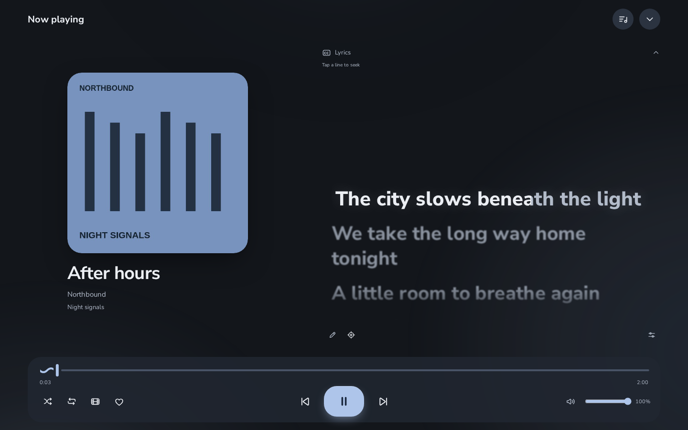
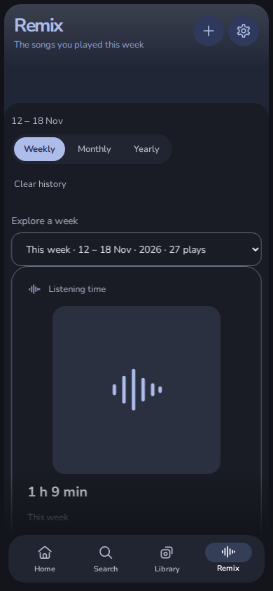
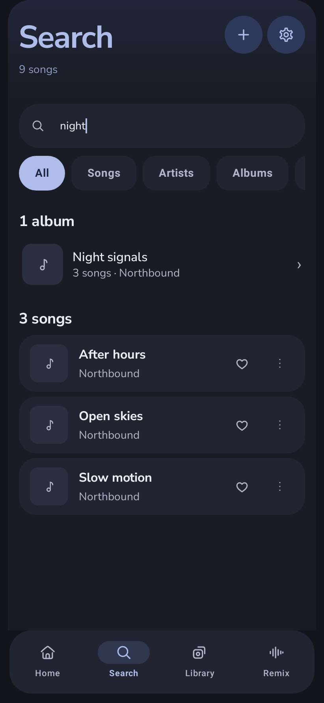
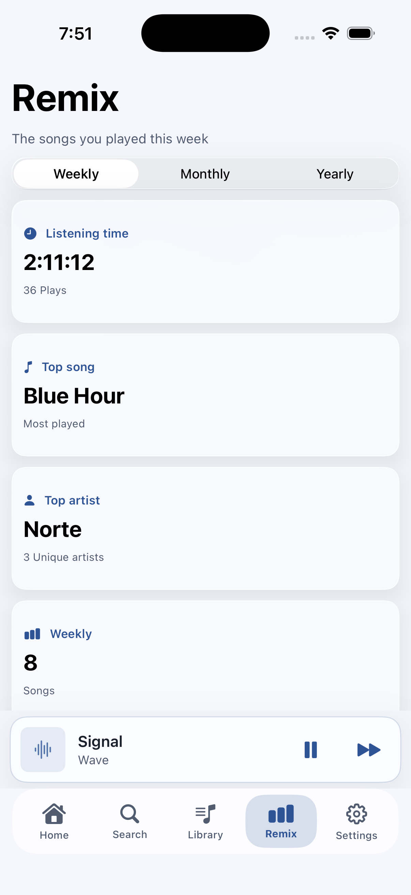
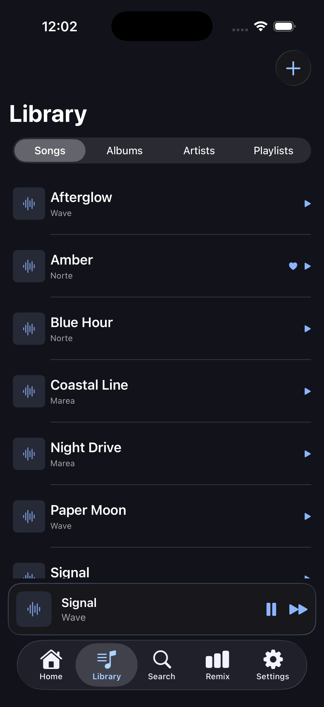
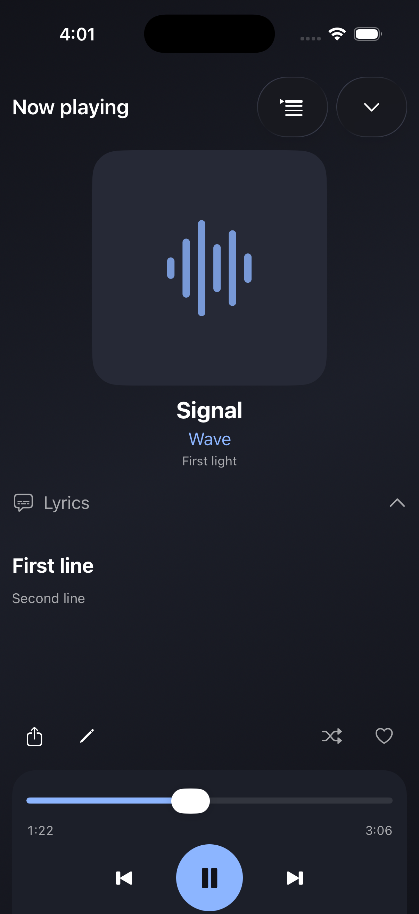

<p align="center"></p>
<p align="center"><strong>Your music files, played properly.</strong></p>
<p align="center"><a href="https://wave.jaime-gaming.com">wave.jaime-gaming.com</a> · Development <strong>0.3.0</strong> · <a href="#get-started">Get started</a> · <a href="docs/WHY_WAVE.md">Why Wave</a> · <a href="docs/media/wave-promo.mp4">Introduction film</a> · <a href="docs/RELEASE_NOTES_0.3.0.md">What's new</a></p>


Wave plays the music you already own: the MP3s, FLACs and WAVs in your folders. Nothing is
uploaded, there is no account, and the files are never converted. Add them once and they play on
the web, on Windows and on Android.

## Get started

You need [Node.js](https://nodejs.org) 22.12 or newer.

```sh
git clone https://github.com/jaime-gaming/Wave.git
cd Wave
npm ci
npm run dev
```

Open the address the terminal prints, press **Add music**, pick your files, and press play.
Nothing else needs setting up. The same build is published at
[wave.jaime-gaming.com](https://wave.jaime-gaming.com).

Windows and Android builds are on the [Releases](https://github.com/jaime-gaming/Wave/releases)
page when published. In the web app, About links start the latest public download directly without navigating the release page. The current 0.2.1 release contains a Windows unsigned ZIP and an Android test APK; the prepared 0.2.2 release targets a self-contained `Wave.exe` and signed `Wave.apk`.
Windows may show a SmartScreen warning and Android asks you to allow installation. Signing and
update compatibility depend on the release credentials; CI-only builds may use temporary keys.

## What it does

In the expanded web player, use **Space** to play/pause, **Left/Right** to seek five seconds,
**Up/Down** for volume and **M** to mute, when focus is not in an interactive control. Windows
supports the same shortcuts in its expanded player. With Fix volume enabled, Song options can
prioritize or reanalyze an individual local recording. The web Mix uses synchronized lyric timestamps
when available to bring an incoming vocal closer to the end of the fade; timing and sound depend on
the files and analysis, and no lyrics are sent for this purpose.

- **Plays your files.** MP3, WAV, M4A, OGG and FLAC, up to 200 MB each, at their original
  quality.
- **Takes a whole folder.** Point Wave at a folder and it reads every song inside it, at any
  depth, once you have said yes; it remembers the folder so the next read is one click.
- **Browses and searches** songs, albums, artists, playlists and favourites from your own
  collection, ranked by how well they answer, and forgiving a letter in the wrong place.
- **Fills in the gaps.** Songs that know nothing but their filename get their artist, album, year,
  genre and cover looked up while you listen — never over something you typed.
- **Daily mixes** built from your genres or local mood groups (7–20 tracks, up to 3 mixes,
  day-locked covers and wide artist spacing): play one, shuffle it, or save it as a playlist.
- **Lyrics that follow the song**, word by word when the file carries timings. Saved lyrics work
  offline.
- **Studio-grade Mix** joins two songs on a bar with Camelot musical-key awareness, 3-band EQ
  handovers (bass swap, vocal mid-pocket carve and air roll-off), stereo spread and live level
  matching, each record at its original tempo. The files on disk are untouched.
- **100% local Mood Engine** silently tracks audio cues, genres, bilingual themes and live
  listening momentum on-device to guide Home recommendations and AutoPlay with zero cloud calls.
- **Remix**: Weekly, Monthly and Yearly recaps backed by a full year of local history — one
  headline number, the songs you played most, and a list you can play or save as a playlist.
- **Fix volume**: K-weighted BS.1770 LUFS loudness leveling that boosts quiet tracks cleanly
  without touching already-balanced masters or modifying source files.
- **Real video clips** behind the player, muted, full screen, drawn under the player's own text and
  with no YouTube interface showing. A still picture is not a clip, so a song either has a moving
  one or none.
- **YouTube search & links**, with offline awareness, for the songs you do not own yet.
- **Brings playlists over** from another app: try a public Spotify/YouTube URL, paste a list or choose its exported `.m3u` or
  `.csv`, see which songs you already have, and turn the confirmed ones into a playlist.
- **Device linking** with a QR code and no server, so two of your devices can share a song by
  transfer. Nothing already saved is ever deleted.

## Screenshots

**Remix**, the week in one number and the playlist it earns:


**A daily mix**, listed before anything plays:


**Now Playing**, with the sung line following the song:



<p align="center">
  
  
</p>

**Windows**, the same library in a native window:


A search names what it found before it lists it — the artists, albums and playlists whose names
match, each one a row that opens it:


**Android**, from the built app itself:

<p align="center">
  
  
  
  
</p>

**iOS**, rendered by the SwiftUI app itself:

<p align="center">
  
  
  
  
</p>

Every image is a real capture, not a mock-up. The web ones come from `npm run capture:docs`
against a generated demo library; the Windows ones are drawn by `Wave.exe --smoke-test`
on its own throwaway library; the Android ones are rendered by the app's `ScreenshotTest` on the
real Compose stack; the iOS ones are simulator screenshots of the running SwiftUI app on a seeded
in-memory library. Each of those runs on CI and commits what it produced, so the pictures here
are the current build. See [Platforms](docs/PLATFORMS.md) for the pages that are not shown.

## Why Wave, next to Spotify, Apple Music or YouTube Music

Those services rent you a catalogue. Wave is for the music you already have — bought, ripped from
a CD, downloaded from a band's Bandcamp, recorded yourself — and it treats those files the way a
service never will:

- **Nothing is re-encoded.** Spotify streams a compressed copy at a fixed bitrate. Wave plays your
  FLAC as a FLAC, and Mix changes only how two songs are joined, never the audio in the file.
- **No subscription, no account, no ads, no telemetry.** There is nothing to sign into and nothing
  to cancel.
- **It works without a connection**, including the lyrics you already saved and your whole
  library.
- **The library is yours.** It lives in your browser, on your disk or in the app's own folder, and
  clearing it is one button, not a support request.
- **It is open source**, so you can read what it does with your files, and run your own copy.

What it does not do: it has no catalogue to stream, so a song you do not own is not there — you
can search or add it from YouTube by link, or buy the file. There is no social feed, no cloud sync
between devices, and no server-side profiling (all mood matching and AutoPlay run 100% locally on
your own collection). [Why Wave](docs/WHY_WAVE.md) has the full comparison, including the parts
where the big services are the better choice.

## Where it runs

|                                       | Web | Windows | Android |
| ------------------------------------- | --- | ------- | ------- |
| Play a local library                  | Yes | Yes     | Yes     |
| Mix, lyrics, daily mixes              | Yes | Yes     | Yes     |
| Remix (weekly recap and playlist)     | Yes | Yes     | Yes     |
| Search by song, artist, album, list   | Yes | Yes     | Yes     |
| Link two devices with a QR code       | Yes | No      | No      |
| Video clips, YouTube songs            | Yes | No      | No      |
| Lock screen, headset and car controls | —   | —       | Yes     |
| Works offline as an installed app     | Yes | Yes     | Yes     |

**iOS.** A SwiftUI app for iPhone and iPad (iOS 17+) is in
[`platforms/ios`](platforms/ios/README.md). It imports local audio and LRC files, plays in the
background and answers the lock screen, Control Center, headphones and CarPlay. It also has
WidgetKit home/lock-screen widgets, a Live Activity with Dynamic Island and CarPlay, App Intents
for Siri/Shortcuts/Spotlight, an iOS 18 Control Center control, Handoff and the system Share
sheet. **Liquid Glass is used only in this iOS app**, with the real iOS 26 APIs and an iOS 17
material fallback. Open `Wave.xcodeproj` in Xcode 26 or follow the simulator commands in
[Platforms](docs/PLATFORMS.md#ios). It is source-only for now: no signing, no `.ipa` in Release
assets and no App Store upload. Wave still installs to the Home Screen from Safari as an app.

**Browser.** The instructions above are all you need. You can install Wave to a home screen and
it opens without a connection once loaded. The published site is built and served by
[Cloudflare](docs/PLATFORMS.md#browser-and-cloudflare); to host your own copy, see the
same page.

**Windows.** A native C#/WPF app. Run `Wave.exe` and add your
folders: there is no runtime to install first. Builds without a trusted signature can trigger SmartScreen; see
[Windows release preparation](docs/WINDOWS_RELEASE.md).

**Android.** A native Kotlin/Compose app for API 26 and newer, installed from the APK in the
download; no cable and no developer tools. Import files, a folder or the music
your phone already indexes, and playback continues with the screen off, from the lock screen, the
quick settings tile or your headphones. Its interface follows the mobile website; the remaining
feature and device-testing gaps are listed in [Platforms](docs/PLATFORMS.md#android).

## Your files and your privacy

- Music and library storage stay on your device. There are no accounts or analytics; the optional public-link reader uses the Wave Worker for metadata only.
- Lyric search is off until you turn it on. It sends the song title and artist to LRCLIB.
- Clip discovery sends the song title and artist to public YouTube front-ends. Video and YouTube
  songs stream from YouTube.
- Imported audio is kept once, at its original quality. Wave is a player, not a backup: keep your
  original files.
- Clearing your browser's site data deletes the collection, so treat the library as a copy.

Full details are in [Privacy and data flow](PRIVACY.md).

## Documentation

- [Why Wave](docs/WHY_WAVE.md) — how it compares with the streaming services.
- [Platforms, downloads and build steps](docs/PLATFORMS.md)
- [Development, tests and release checks](docs/DEVELOPMENT.md)
- [Roadmap](docs/ROADMAP.md)
- [Architecture](docs/ARCHITECTURE.md) · [Design](docs/DESIGN.md) · [API reference](docs/API_REFERENCE.md)
- [Validation results and known limits](docs/VALIDATION.md) · [Changelog](CHANGELOG.md)

## Contributing

Read [CONTRIBUTING.md](CONTRIBUTING.md) and the [Code of Conduct](CODE_OF_CONDUCT.md) first.
Wave is licensed under the [MIT License](LICENSE); dependencies keep their own licences, listed
in [third-party notices](THIRD_PARTY_NOTICES.md).

Wave is not affiliated with Spotify, Apple, Google or YouTube. The client is free and open source;
that says nothing about the music, lyrics or covers you add to it, which remain subject to their
own rights.

<p align="center"></p>

Maintained by [Jaime Gaming](https://github.com/jaime-gaming).
