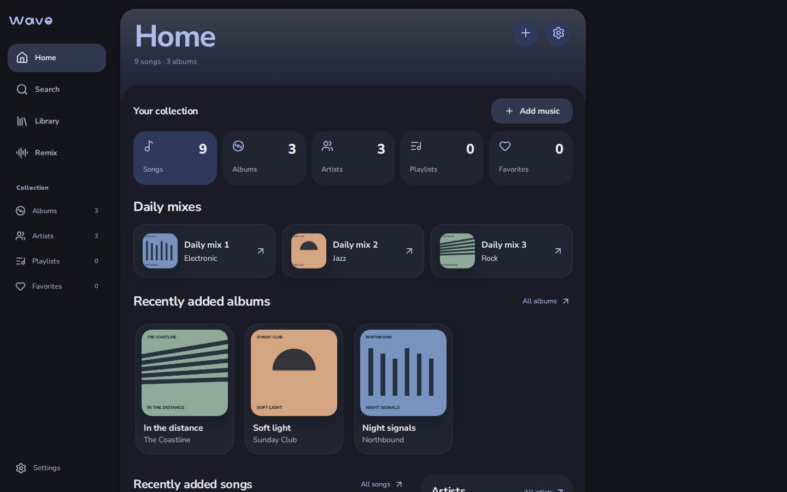
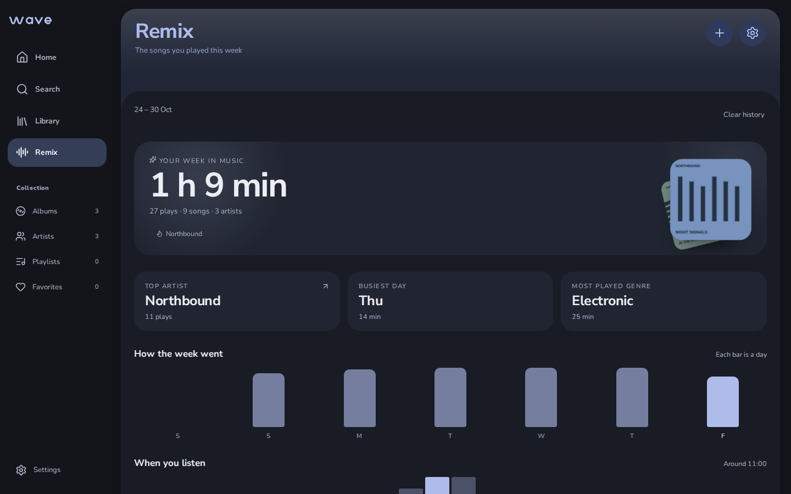
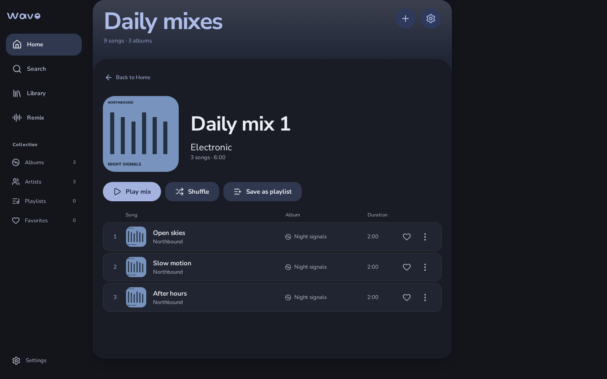
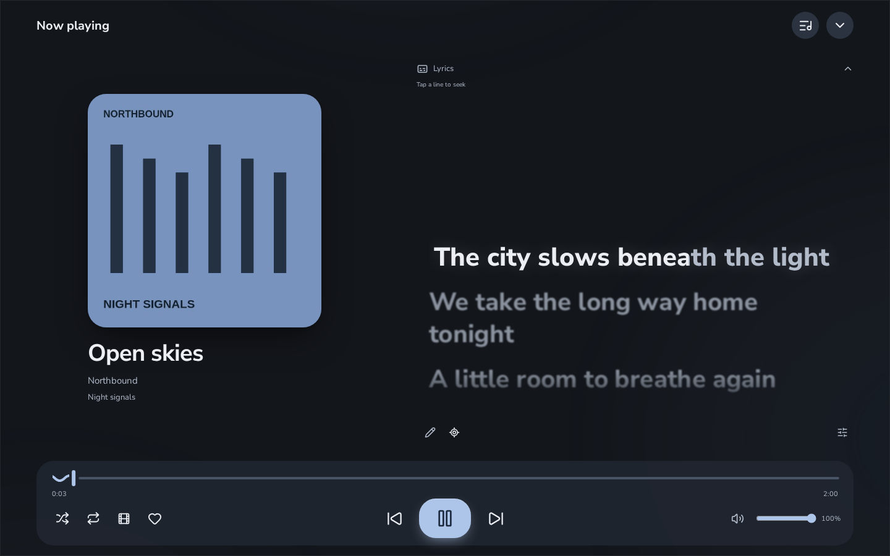
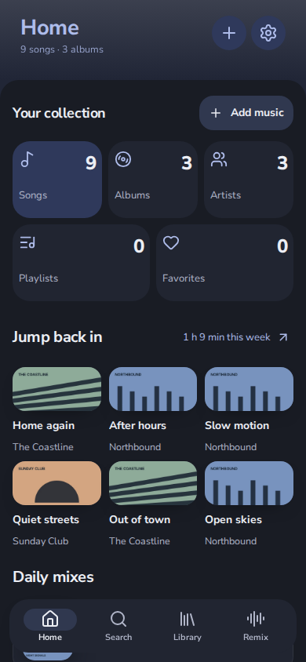
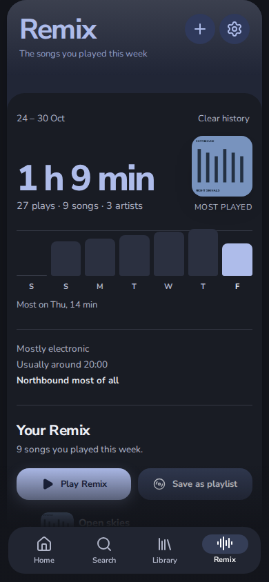
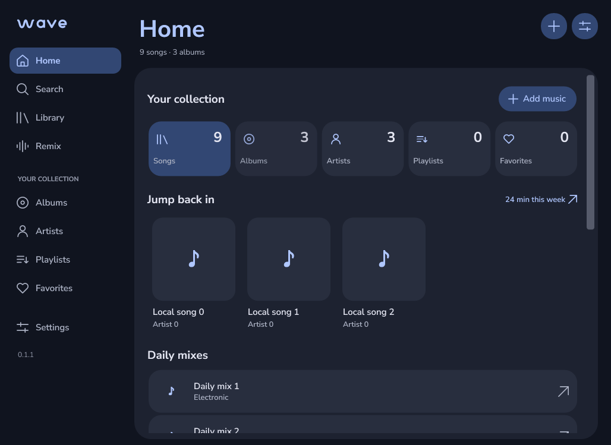
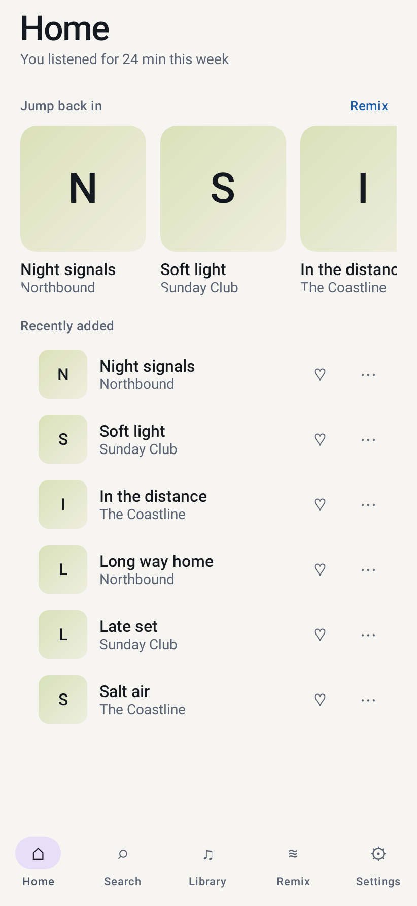
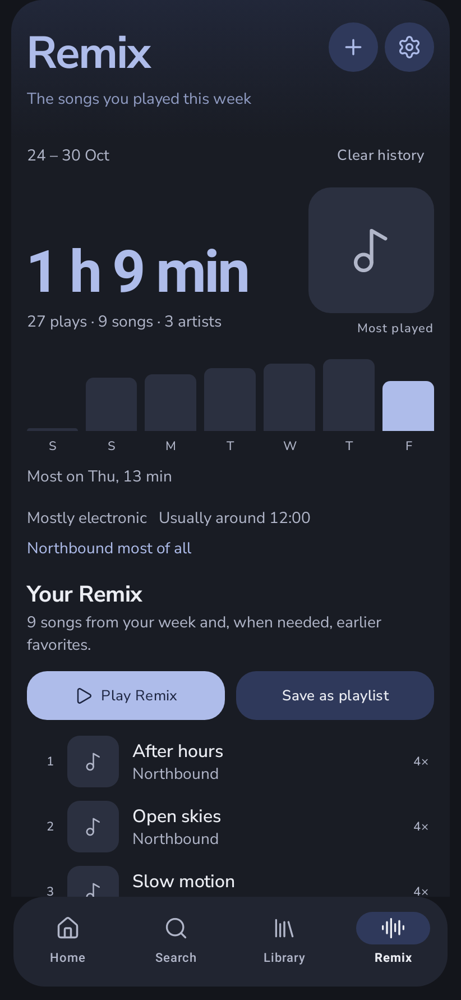
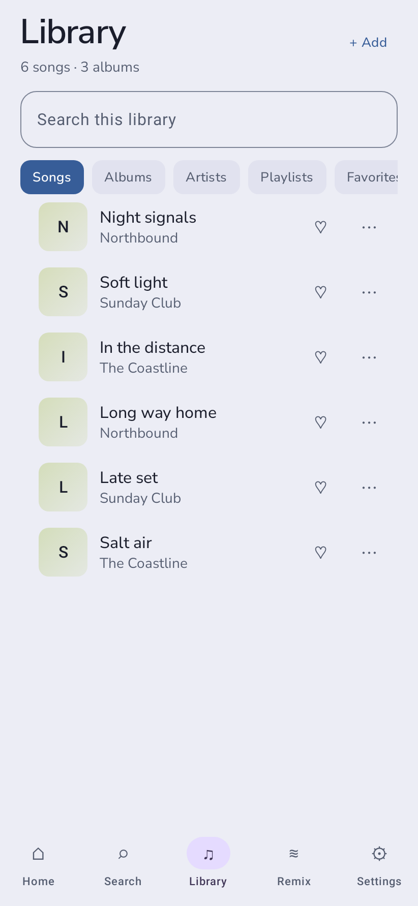

<p align="center"></p>
<h1 align="center">Wave</h1>
<p align="center"><strong>Your music files, played properly.</strong></p>
<p align="center">Version <strong>0.1.1</strong> · <a href="#get-started">Get started</a> · <a href="docs/WHY_WAVE.md">Why Wave</a> · <a href="docs/media/wave-promo.mp4">Watch the demo</a> · <a href="docs/RELEASE_NOTES_0.1.1.md">What's new</a></p>



Wave plays the music you already own: the MP3s, FLACs and WAVs in your folders. Nothing is
uploaded, there is no account, and the files are never converted. Add them once and they play on
the web, on Windows and on Android.

## Get started

You need [Node.js](https://nodejs.org) 22.12 or newer.

```sh
git clone https://github.com/jaime-gaming/Wave.git
cd Wave
npm ci
npm run dev
```

Open the address the terminal prints, press **Add music**, pick your files, and press play.
Nothing else needs setting up.

Windows and Android builds are on the [Releases](https://github.com/jaime-gaming/Wave/releases)
page. Both are unsigned test builds, not store installers.

## What it does

- **Plays your files.** MP3, WAV, M4A, OGG and FLAC, up to 200 MB each, at their original
  quality.
- **Browses and searches** songs, albums, artists, playlists and favourites from your own
  collection.
- **Daily mixes** from the genre tags your files already carry: play one, shuffle it, or save it
  as an ordinary playlist.
- **Lyrics that follow the song**, word by word when the file carries timings. Saved lyrics work
  offline.
- **Mix** joins two songs on a bar with a 16 to 24 second overlap, beat-matched and level-matched
  on the fly. The files on disk are untouched.
- **Remix**: the week you just had. One number, the songs you played most, and a list you can
  play or save as a playlist.
- **Real video clips** behind the player, muted and full screen with no YouTube interface
  showing.
- **YouTube songs** by link, for the ones you do not own yet.
- **Device linking** with a QR code and no server, so two of your devices can share a song by
  transfer. Nothing already saved is ever deleted.

## Screenshots

**Remix**, the week in one number and the playlist it earns:



**A daily mix**, listed before anything plays:



**Now Playing**, with the sung line following the song:



<p align="center">
  
  
</p>

**Windows**, the same library in a native window:



**Android**, from the built app itself:

<p align="center">
  
  
  
</p>

Every image is a real capture, not a mock-up. The web ones come from `npm run capture:docs`
against a generated demo library; the Windows ones are drawn by `Wave.Windows.exe --smoke-test`
on its own throwaway library; the Android ones are rendered by the app's `ScreenshotTest` on the
real Compose stack. Each of those runs on CI and commits what it produced, so the pictures here
are the current build. See [Platforms](docs/PLATFORMS.md) for the pages that are not shown.

## Why Wave, next to Spotify, Apple Music or YouTube Music

Those services rent you a catalogue. Wave is for the music you already have — bought, ripped from
a CD, downloaded from a band's Bandcamp, recorded yourself — and it treats those files the way a
service never will:

- **Nothing is re-encoded.** Spotify streams a compressed copy at a fixed bitrate. Wave plays your
  FLAC as a FLAC, and Mix changes only how two songs are joined, never the audio in the file.
- **No subscription, no account, no ads, no telemetry.** There is nothing to sign into and nothing
  to cancel.
- **It works without a connection**, including the lyrics you already saved and your whole
  library.
- **The library is yours.** It lives in your browser, on your disk or in the app's own folder, and
  clearing it is one button, not a support request.
- **It is open source**, so you can read what it does with your files, and run your own copy.

What it does not do: it has no catalogue to stream, so a song you do not own is not there — you
can add it from YouTube by link, or buy the file. There is no social feed, no cloud sync between
devices, and no recommendation engine. [Why Wave](docs/WHY_WAVE.md) has the full comparison,
including the parts where the big services are the better choice.

## Where it runs

|                                       | Web | Windows | Android |
| ------------------------------------- | --- | ------- | ------- |
| Play a local library                  | Yes | Yes     | Yes     |
| Mix, lyrics, daily mixes              | Yes | Yes     | Yes     |
| Remix (weekly recap and playlist)     | Yes | Yes     | Yes     |
| Video clips, YouTube songs            | Yes | No      | No      |
| Lock screen, headset and car controls | —   | —       | Yes     |
| Works offline as an installed app     | Yes | Yes     | Yes     |

**Browser.** The instructions above are all you need. You can install Wave to a home screen and
it opens without a connection once loaded. To host it yourself, see
[GitHub Pages](docs/PLATFORMS.md#browser-and-github-pages).

**Windows.** A native C#/WPF app. Unzip it, run `Wave.Windows.exe` after installing the .NET 10
Desktop Runtime, and add your folders. Unsigned builds can trigger SmartScreen; see
[Windows release preparation](docs/WINDOWS_RELEASE.md).

**Android.** A native Kotlin/Compose app for API 26 and newer. Import files, a folder or the music
your phone already indexes, and playback continues with the screen off, from the lock screen, the
quick settings tile or your headphones.

## Your files and your privacy

- Everything stays on your device. There is no backend, no analytics, no account.
- Lyric search is off until you turn it on. It sends the song title and artist to LRCLIB.
- Clip discovery sends the song title and artist to public YouTube front-ends. Video and YouTube
  songs stream from YouTube.
- Imported audio is kept once, at its original quality. Wave is a player, not a backup: keep your
  original files.
- Clearing your browser's site data deletes the collection, so treat the library as a copy.

Full details are in [Privacy and data flow](PRIVACY.md).

## Documentation

- [Why Wave](docs/WHY_WAVE.md) — how it compares with the streaming services.
- [Platforms, downloads and build steps](docs/PLATFORMS.md)
- [Development, tests and release checks](docs/DEVELOPMENT.md)
- [Roadmap](docs/ROADMAP.md)
- [Architecture](docs/ARCHITECTURE.md) · [Design](docs/DESIGN.md) · [API reference](docs/API_REFERENCE.md)
- [Validation results and known limits](docs/VALIDATION.md) · [Changelog](CHANGELOG.md)

## Contributing

Read [CONTRIBUTING.md](CONTRIBUTING.md) and the [Code of Conduct](CODE_OF_CONDUCT.md) first.
Wave is licensed under the [MIT License](LICENSE); dependencies keep their own licences, listed
in [third-party notices](THIRD_PARTY_NOTICES.md).

Wave is not affiliated with Spotify, Apple, Google or YouTube. The client is free and open source;
that says nothing about the music, lyrics or covers you add to it, which remain subject to their
own rights.

Maintained by [Jaime Gaming](https://github.com/jaime-gaming).
