# Wave: tu música, en tu espacio

[**Abrir Wave**](https://wave.jaime-gaming.com) · [Descargas](https://github.com/jaime-gaming/Wave/releases) · [English](../README.md) · [Por qué Wave](WHY_WAVE.md) · [Vídeo de presentación](media/wave-promo.mp4) · [Documentación](README.md)

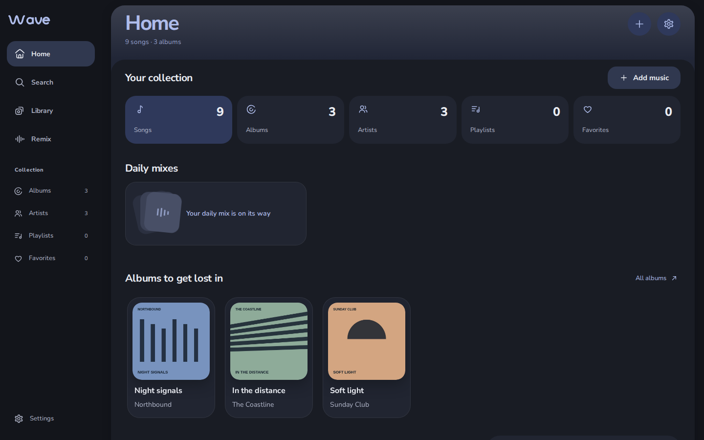

Wave es un reproductor para los archivos de música que ya tienes. Organiza tu biblioteca, crea
listas, sigue las letras y descubre de nuevo lo que escuchas con Remix. Puedes empezar en el
navegador y también explorar las aplicaciones nativas de Windows, Android e iOS.

**Estado:** este código corresponde a Wave **0.3.0 en desarrollo**. La web pública y las
[versiones descargables](https://github.com/jaime-gaming/Wave/releases) pueden ser anteriores y
no incluir todavía todo lo que se muestra aquí.

## Empezar

### En el navegador

1. Abre [wave.jaime-gaming.com](https://wave.jaime-gaming.com) en un navegador moderno.
2. Pulsa **Añadir música** y selecciona tus archivos. El acceso a carpetas depende del navegador.
3. Elige una canción y dale a reproducir. También puedes instalar la aplicación web si tu
   navegador lo permite.

Los archivos locales no se suben para reproducirlos. Conserva los originales: borrar los datos
del navegador o desinstalar una aplicación puede eliminar las copias guardadas por Wave. Los
formatos compatibles dependen también del navegador y sus códecs.

### Aplicaciones nativas

| Plataforma  | Cómo empezar                                                                                                             | A tener en cuenta                                                                                                                                                                                                                         |
| ----------- | ------------------------------------------------------------------------------------------------------------------------ | ----------------------------------------------------------------------------------------------------------------------------------------------------------------------------------------------------------------------------------------- |
| **Android** | Descarga el APK desde [Releases](https://github.com/jaime-gaming/Wave/releases) y sigue las indicaciones de instalación. | Las actualizaciones sobre una instalación existente requieren la misma clave de firma.                                                                                                                                                    |
| **Windows** | Comprueba si hay una descarga para Windows en [Releases](https://github.com/jaime-gaming/Wave/releases).                 | La versión pública 0.2.2 no incluye ejecutable de Windows; hay un ZIP sin firmar anterior. Windows puede mostrar un aviso de seguridad. El `Wave.exe` independiente está configurado para futuras versiones, no necesariamente publicado. |
| **iOS**     | Consulta cómo compilar el [proyecto SwiftUI](../platforms/ios/README.md) con Xcode 26.                                   | Por ahora es código fuente y compilación para simulador: no hay IPA firmado ni publicación en App Store. Para un dispositivo físico hace falta configurar la firma.                                                                       |

Cada aplicación tiene una **biblioteca independiente**; instalar otra no mueve ni sincroniza tu
música automáticamente. Las funciones no son idénticas: consulta la [comparativa de plataformas](PLATFORMS.md).

## Qué puedes hacer

- Organizar canciones, álbumes, artistas, favoritos y listas; crear mezclas diarias y explorar Remix.
- Importar letras LRC y seguirlas mientras suena la música. Las búsquedas en línea son opcionales
  y envían datos de la canción al proveedor elegido.
- En la web, buscar o añadir enlaces públicos de YouTube y reproducirlos en su reproductor
  integrado. Se necesita conexión y el proveedor o navegador pueden imponer restricciones. Wave
  no descarga el audio de YouTube. En Android e iOS se trata de una vista previa separada de la cola nativa.
- En la web, traer listas públicas de Spotify, YouTube o Deezer, pegar texto o elegir un archivo
  M3U/CSV. Revisa y corrige las coincidencias antes de guardar. Las listas privadas o parcialmente
  visibles pueden requerir una exportación; no se garantiza encontrar todas las canciones.
- En la web, enlazar dispositivos de forma explícita y exportar copias cifradas. La restauración
  requiere una biblioteca web vacía; comprueba la huella del dispositivo por otra vía y conserva
  la contraseña y los archivos originales. Las apps nativas aún no son compatibles con ese formato.
  [Más sobre las copias](BACKUP_FORMAT.md).

Wave no requiere una cuenta ni sincroniza automáticamente la biblioteca en la nube. Algunas
funciones opcionales contactan con terceros: consulta [privacidad y flujo de datos](../PRIVACY.md).

## Dónde funciona

Wave tiene cuatro clientes independientes. «Sí» indica que la función existe en el código actual,
no que sea idéntica en todas las plataformas ni que esté en la última descarga pública.

| Función                                     | Web                                       | Windows          | Android                    | iOS                        |
| ------------------------------------------- | ----------------------------------------- | ---------------- | -------------------------- | -------------------------- |
| Biblioteca local, listas y búsqueda         | Sí                                        | Sí               | Sí                         | Sí                         |
| Mix, letras y Daily Mix                     | Sí                                        | Sí               | Sí                         | Sí, Daily Mix más sencillo |
| Resúmenes de escucha Remix                  | Sí                                        | Sí               | Sí                         | Sí                         |
| Letras en línea opcionales                  | Sí                                        | Sí               | Sí                         | Sí, LRCLIB                 |
| Datos de canciones en línea opcionales      | Auto Fill y editor                        | Aún no           | Aún no                     | Búsqueda explícita         |
| YouTube                                     | Búsqueda, enlaces y reproductor integrado | Aún no           | Vista previa independiente | Vista previa independiente |
| Enlazar dispositivos y transferir canciones | Clientes web                              | Solo cliente web | Solo cliente web           | Solo cliente web           |
| Copia web cifrada y restauración            | Sí                                        | Aún no           | Aún no                     | Aún no                     |

Las vistas previas nativas de YouTube no añaden vídeos a la biblioteca ni a la cola nativas. Las
bibliotecas son independientes y no se sincronizan automáticamente. Consulta las diferencias de
Mix, archivos y controles del sistema en la [comparativa de plataformas](PLATFORMS.md).

## Capturas

Un recorrido por Wave con bibliotecas de demostración. Las imágenes muestran el **código en
desarrollo**, no necesariamente la última versión publicada. Las capturas web proceden de la web
compilada; las de Windows, de la prueba WPF; las de Android, del entorno de pruebas Compose; y las
de iOS, de un simulador de iPhone. No son pruebas en dispositivos físicos ni de calidad de audio.
[Cómo se generan las capturas](SCREENSHOTS.md) (en inglés).

### Web

**Reproduciendo**, con las letras siguiendo la canción, y **Remix**, con tu resumen de escucha.

| Reproductor                                                            | Remix                                                           |
| ---------------------------------------------------------------------- | --------------------------------------------------------------- |
| 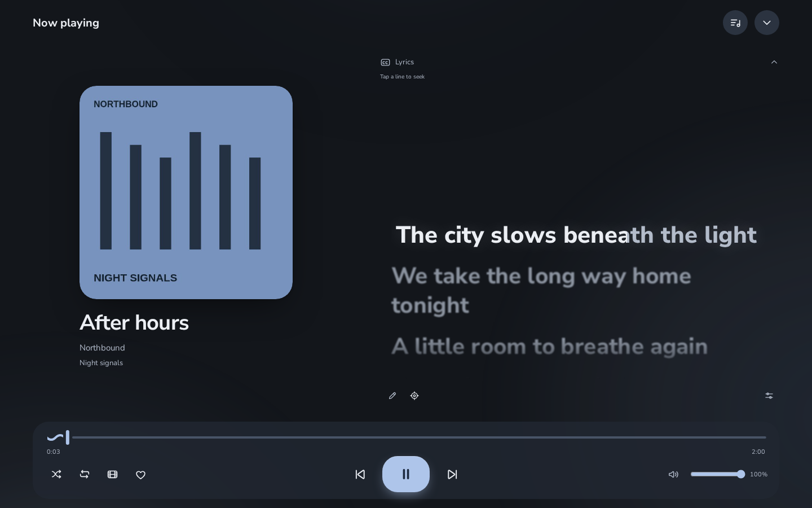 |  |

**Daily Mix** reúne una selección antes de empezar a escuchar. En un teléfono, la biblioteca y
los controles se adaptan a la pantalla.

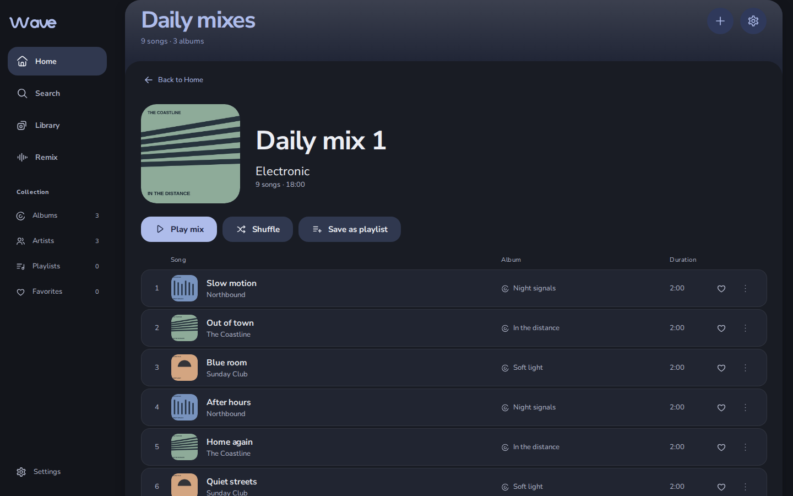

<p align="center">
  
  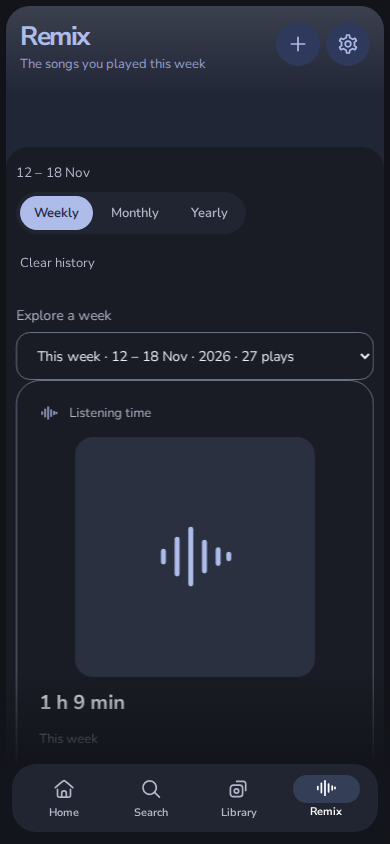
</p>

### Windows

La colección local y la búsqueda en la aplicación nativa WPF.

| Inicio                                                                                   | Búsqueda                                                         |
| ---------------------------------------------------------------------------------------- | ---------------------------------------------------------------- |
| 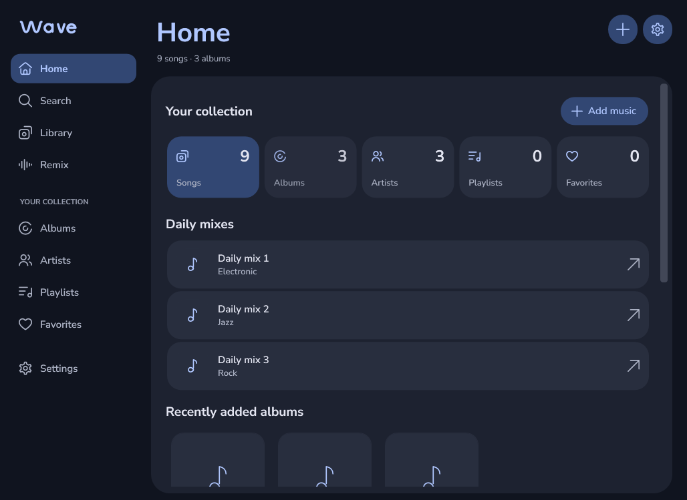 | 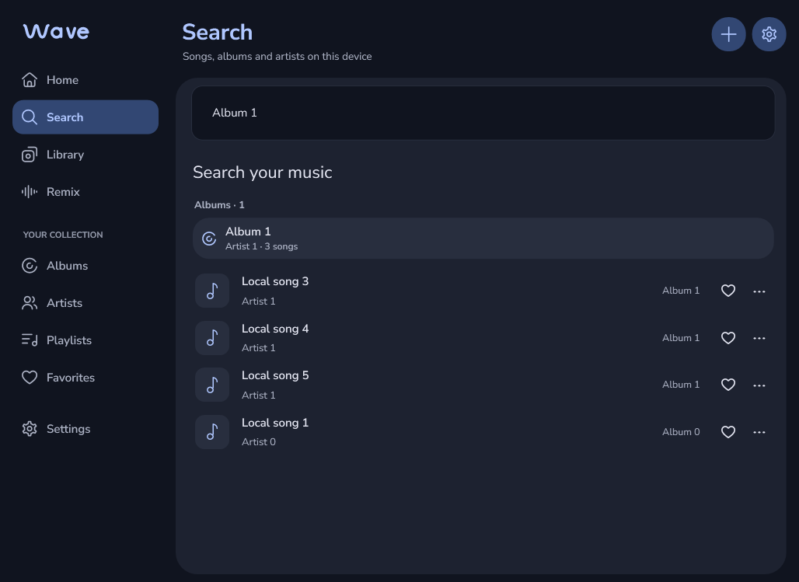 |

[Guía y compilación de Windows](../platforms/windows/README.md)

### Android

Inicio, biblioteca local y Remix en la aplicación nativa Compose.

<p align="center">
  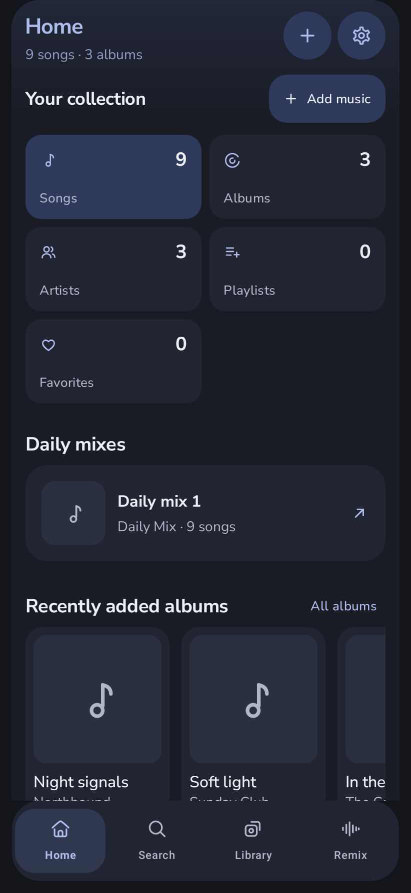
  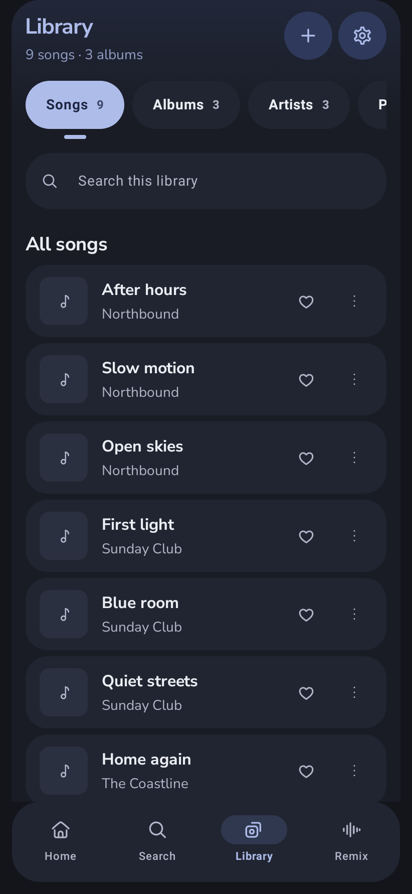
  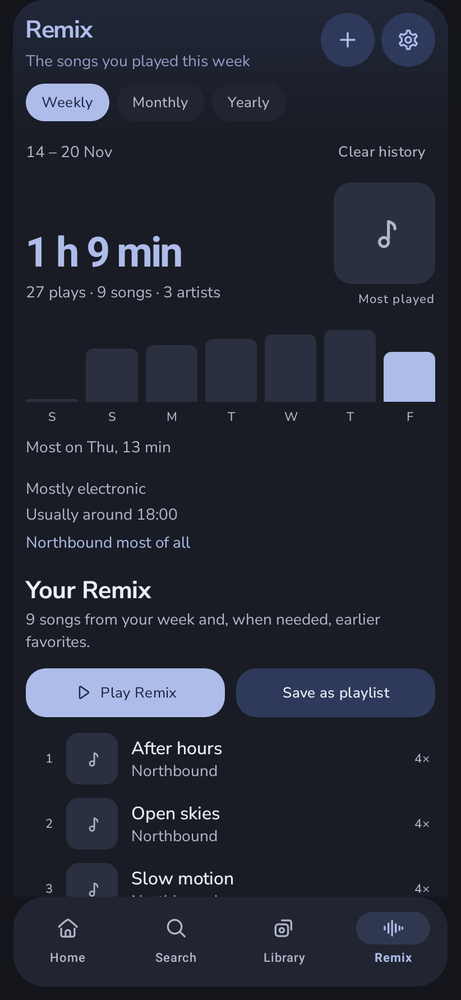
</p>

[Guía y compilación de Android](../platforms/android/README.md)

### iOS y iPadOS

La aplicación SwiftUI, desde el inicio hasta la biblioteca y el reproductor ampliado. Las imágenes
son de un simulador de iPhone; la aplicación también se adapta al iPad.

<p align="center">
  
  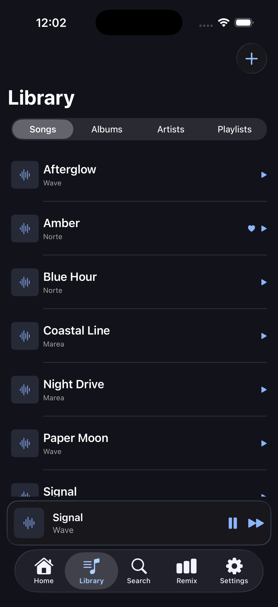
  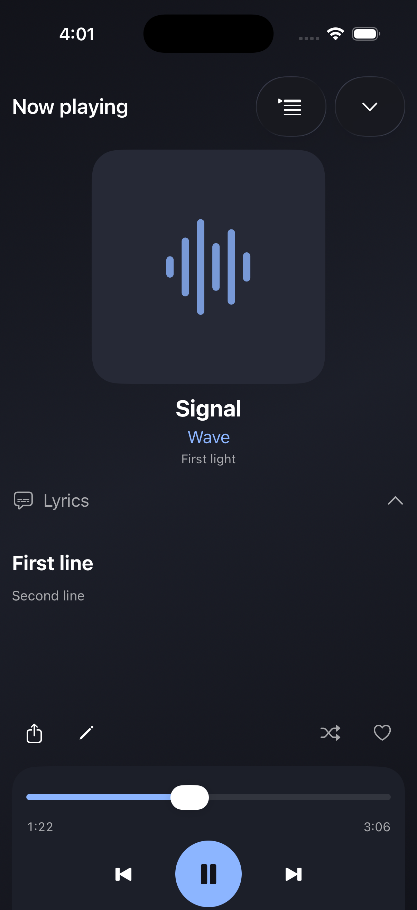
</p>

[Guía y compilación de iOS](../platforms/ios/README.md)

## ¿Por qué Wave?

Wave está pensado para la música que ya tienes: puedes escuchar y organizar tu colección sin una
cuenta ni una suscripción de Wave. La reproducción local, las letras guardadas y el historial
permanecen en tu dispositivo; tus archivos originales no se recodifican. El proyecto es de código
abierto y puedes ejecutar tu propia copia.

No sustituye a un catálogo de streaming ni a una copia de seguridad en la nube. Algunas funciones
hacen solicitudes opcionales a Internet, YouTube está sujeto a las condiciones de su proveedor y
la compatibilidad de códecs o el uso sin conexión varían según la plataforma. [Por qué Wave](WHY_WAVE.md)
explica tanto las ventajas como sus límites.

## Ejecutar el código

Necesitas Git y Node.js **22.12 o posterior de la serie 22, o 24 o posterior**:

```sh
git clone https://github.com/jaime-gaming/Wave.git
cd Wave
npm ci
npm run dev
```

Abre la dirección que muestra Vite. Para compilar la web, ejecuta `npm run build` y después
`npm run preview`. No hace falta una clave de API para el reproductor local. Desplegar la web
es una acción independiente. Para compilar las versiones nativas, consulta
[Android](PLATFORMS.md#android), [Windows](PLATFORMS.md#windows) e [iOS](../platforms/ios/README.md).

## Más información

[Documentación](README.md) · [Desarrollo](DEVELOPMENT.md) · [Cambios](../CHANGELOG.md) ·
[Contribuir](../.github/CONTRIBUTING.md) · [Seguridad](../SECURITY.md) · [Licencia MIT](../LICENSE)

La licencia de Wave no modifica los derechos de tu música, letras o portadas. Las dependencias
conservan sus propias [licencias y avisos](../THIRD_PARTY_NOTICES.md).
