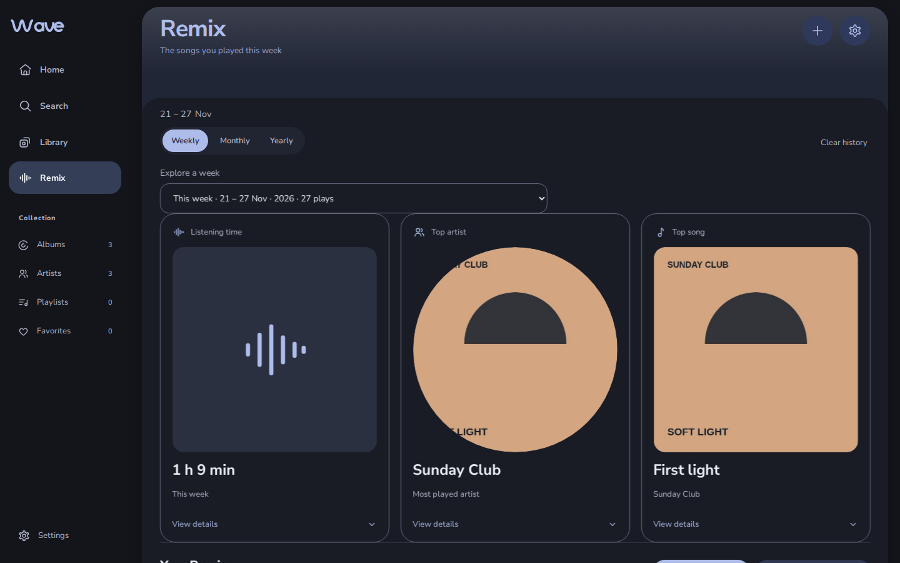
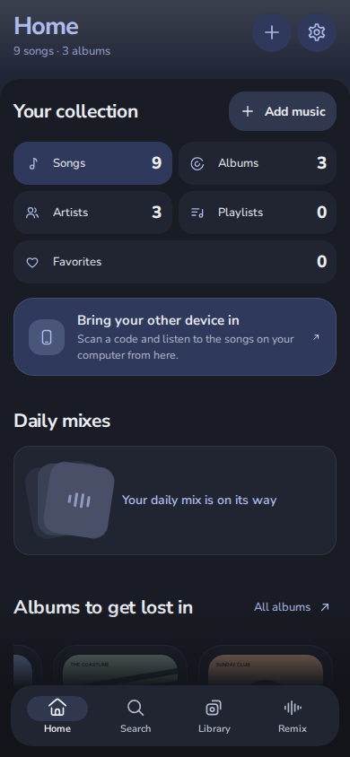
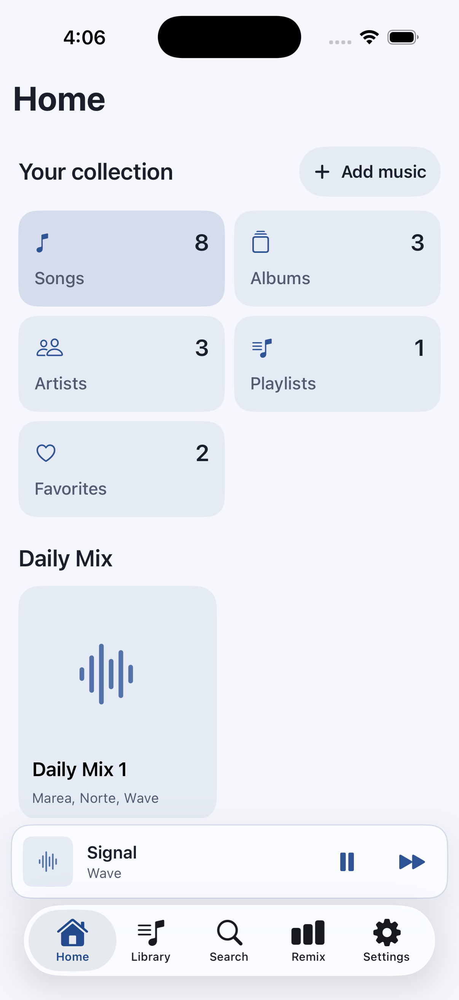

# Wave: tu música, en tu espacio

[**Abrir Wave**](https://wave.jaime-gaming.com) · [Descargas](https://github.com/jaime-gaming/Wave/releases) · [English](../README.md) · [Documentación](README.md)


Wave es un reproductor para los archivos de música que ya tienes. Organiza tu biblioteca, crea
listas, sigue las letras y descubre de nuevo lo que escuchas con Remix. Puedes empezar en el
navegador y también explorar las aplicaciones nativas de Windows, Android e iOS.

**Estado:** este código corresponde a Wave **0.3.0 en desarrollo**. La web pública y las
[versiones descargables](https://github.com/jaime-gaming/Wave/releases) pueden ser anteriores y
no incluir todavía todo lo que se muestra aquí.

## Empezar

### En el navegador

1. Abre [wave.jaime-gaming.com](https://wave.jaime-gaming.com) en un navegador moderno.
2. Pulsa **Añadir música** y selecciona tus archivos. El acceso a carpetas depende del navegador.
3. Elige una canción y dale a reproducir. También puedes instalar la aplicación web si tu
   navegador lo permite.

Los archivos locales no se suben para reproducirlos. Conserva los originales: borrar los datos
del navegador o desinstalar una aplicación puede eliminar las copias guardadas por Wave. Los
formatos compatibles dependen también del navegador y sus códecs.

### Aplicaciones nativas

| Plataforma  | Cómo empezar                                                                                                             | A tener en cuenta                                                                                                                                                                                                                         |
| ----------- | ------------------------------------------------------------------------------------------------------------------------ | ----------------------------------------------------------------------------------------------------------------------------------------------------------------------------------------------------------------------------------------- |
| **Android** | Descarga el APK desde [Releases](https://github.com/jaime-gaming/Wave/releases) y sigue las indicaciones de instalación. | Las actualizaciones sobre una instalación existente requieren la misma clave de firma.                                                                                                                                                    |
| **Windows** | Comprueba si hay una descarga para Windows en [Releases](https://github.com/jaime-gaming/Wave/releases).                 | La versión pública 0.2.2 no incluye ejecutable de Windows; hay un ZIP sin firmar anterior. Windows puede mostrar un aviso de seguridad. El `Wave.exe` independiente está configurado para futuras versiones, no necesariamente publicado. |
| **iOS**     | Consulta cómo compilar el [proyecto SwiftUI](../platforms/ios/README.md) con Xcode 26.                                   | Por ahora es código fuente y compilación para simulador: no hay IPA firmado ni publicación en App Store. Para un dispositivo físico hace falta configurar la firma.                                                                       |

Cada aplicación tiene una **biblioteca independiente**; instalar otra no mueve ni sincroniza tu
música automáticamente. Las funciones no son idénticas: consulta la [comparativa de plataformas](PLATFORMS.md).

## Qué puedes hacer

- Organizar canciones, álbumes, artistas, favoritos y listas; crear mezclas diarias y explorar Remix.
- Importar letras LRC y seguirlas mientras suena la música. Las búsquedas en línea son opcionales
  y envían datos de la canción al proveedor elegido.
- En la web, buscar o añadir enlaces públicos de YouTube y reproducirlos en su reproductor
  integrado. Se necesita conexión y el proveedor o navegador pueden imponer restricciones. Wave
  no descarga el audio de YouTube. En Android e iOS se trata de una vista previa separada de la cola nativa.
- En la web, traer listas públicas de Spotify, YouTube o Deezer, pegar texto o elegir un archivo
  M3U/CSV. Revisa y corrige las coincidencias antes de guardar. Las listas privadas o parcialmente
  visibles pueden requerir una exportación; no se garantiza encontrar todas las canciones.
- En la web, enlazar dispositivos de forma explícita y exportar copias cifradas. La restauración
  requiere una biblioteca web vacía; comprueba la huella del dispositivo por otra vía y conserva
  la contraseña y los archivos originales. Las apps nativas aún no son compatibles con ese formato.
  [Más sobre las copias](BACKUP_FORMAT.md).

Wave no requiere una cuenta ni sincroniza automáticamente la biblioteca en la nube. Algunas
funciones opcionales contactan con terceros: consulta [privacidad y flujo de datos](../PRIVACY.md).

## Capturas

Las imágenes usan bibliotecas de demostración. Muestran el código en desarrollo y no garantizan
que una versión publicada sea idéntica.

| Reproductor web                                                    | Remix en la web                                      |
| ------------------------------------------------------------------ | ---------------------------------------------------- |
|  |  |

<p align="center">
  
  
  
</p>


## Ejecutar el código

Necesitas Git y Node.js **22.12 o posterior de la serie 22, o 24 o posterior**:

```sh
git clone https://github.com/jaime-gaming/Wave.git
cd Wave
npm ci
npm run dev
```

Abre la dirección que muestra Vite. Para compilar la web, ejecuta `npm run build` y después
`npm run preview`. No hace falta una clave de API para el reproductor local. Desplegar la web
es una acción independiente. Para compilar las versiones nativas, consulta
[Android](PLATFORMS.md#android), [Windows](PLATFORMS.md#windows) e [iOS](../platforms/ios/README.md).

## Más información

[Documentación](README.md) · [Desarrollo](DEVELOPMENT.md) · [Cambios](../CHANGELOG.md) ·
[Contribuir](../.github/CONTRIBUTING.md) · [Seguridad](../SECURITY.md) · [Licencia MIT](../LICENSE)

La licencia de Wave no modifica los derechos de tu música, letras o portadas. Las dependencias
conservan sus propias [licencias y avisos](../THIRD_PARTY_NOTICES.md).
