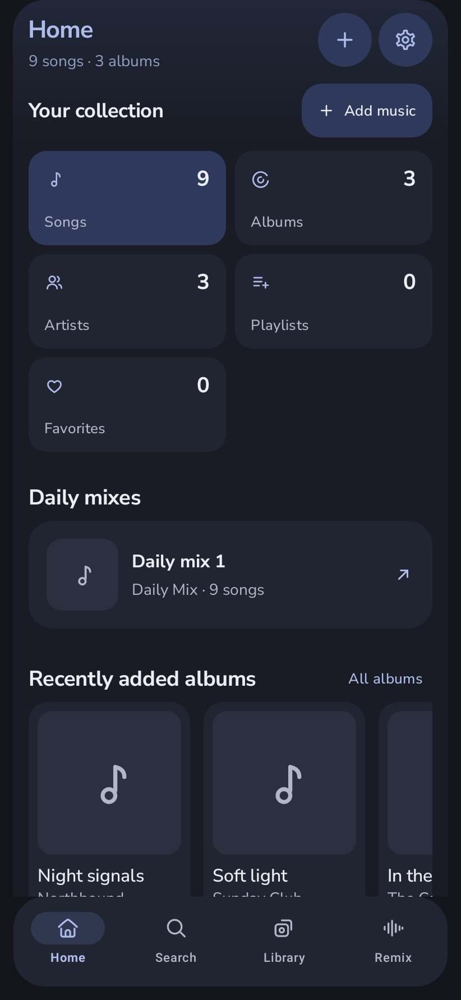
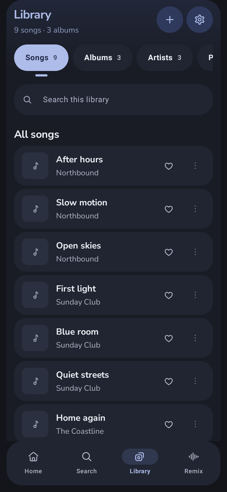

# Wave for Android

[Project overview](../../README.md) · [Español](../../docs/README.es.md) · [Platform comparison](../../docs/PLATFORMS.md)

<p align="center">
  
  
</p>

A native Kotlin and Compose music player for Android 8.0 (API 26) and newer. The images above are
rendered by the Android UI test harness with a demo library; they are not physical-device tests.

## Install

Check [GitHub Releases](https://github.com/jaime-gaming/Wave/releases) for the available APK and
its release notes. Download and open the APK, then follow Android's installation prompts. An
in-place update must use the same signing key as the installed app. The current source may be newer
than the public APK; branch CI packages may use a temporary key and are not necessarily suitable
for updating a public installation.

## Build from source

Install Android Studio, JDK 17, Android SDK and build tools 36, and Gradle 8.13. Open
`platforms/android` in Android Studio or, from the repository root, run:

```sh
gradle -p platforms/android testDebugUnitTest lintDebug assembleDebug
```

The project does not include a Gradle wrapper. Android Studio/Gradle may need network access to
resolve dependencies. Release signing is a separate step: keep signing keys outside the
repository. See the full [Android build and signing notes](../../docs/PLATFORMS.md#android).

## Scope

Local files, library browsing, playlists, Remix, lyrics, playback controls and native media-session
features are implemented. Explicit YouTube search and embedded playback are a separate preview,
not part of the native library or queue. Web device linking, web backup restore and full web
feature parity are not implemented. Libraries are independent; keep your original music. Playback,
background behaviour, accessibility and battery use still need real-device validation.

[Privacy](../../PRIVACY.md) · [Security](../../SECURITY.md) · [Development](../../docs/DEVELOPMENT.md) · [License](../../LICENSE)
