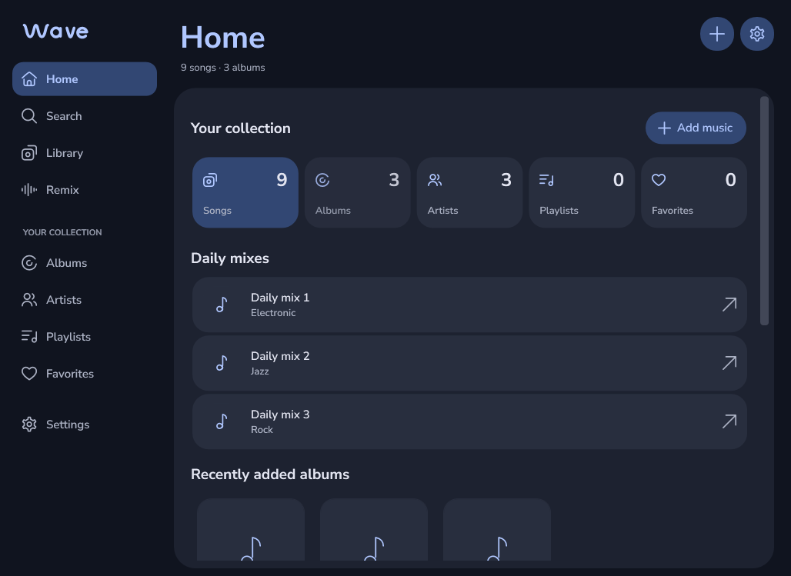
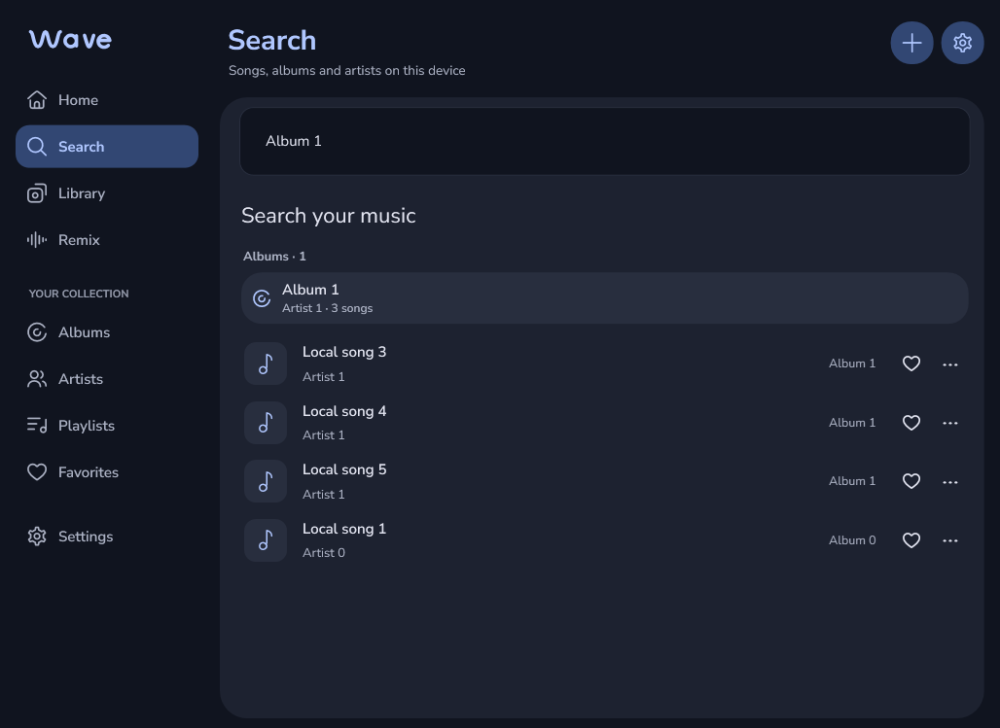

# Wave for Windows

[Project overview](../../README.md) · [Español](../../docs/README.es.md) · [Platform comparison](../../docs/PLATFORMS.md)

| Home                                                                                       | Search                                                                                |
| ------------------------------------------------------------------------------------------ | ------------------------------------------------------------------------------------- |
|  |  |

A native C# and WPF player with a local library, playlists, lyrics and listening recaps. The
screenshot comes from the WPF smoke test using a disposable demo library; it is not a physical
device or audio-quality test. The [capture guide](../../docs/SCREENSHOTS.md) explains how to
reproduce it.

## Install

See [GitHub Releases](https://github.com/jaime-gaming/Wave/releases) for available Windows assets
and their instructions. The latest public 0.2.2 release has no Windows asset; an older release
contains an unsigned ZIP. The current build is configured to produce an unsigned standalone
`Wave.exe` for a future release, but that does not mean it has been published. Windows may show a
security warning for unsigned files; do not disable your security protections to install it.

## Build from source

Use Windows with the .NET 10 SDK. From the repository root:

```powershell
dotnet run --project platforms/windows/Wave.Contracts.Tests -c Release
dotnet build platforms/windows/Wave.Windows -c Release
dotnet run --project platforms/windows/Wave.Windows
```

For the single-file publish command, signing status and distribution limits, see
[Windows release preparation](../../docs/WINDOWS_RELEASE.md).

## Scope

Windows links imported files in place by default; optional copy mode and folders are described in
[Platforms](../../docs/PLATFORMS.md#windows). Its library is independent of the web and other
native apps. YouTube integration, web device linking, Fix Volume and web backup restore are not
available in this app. Codecs depend on Windows; real-device and listening tests are still needed.
Keep the original audio files.

[Privacy](../../PRIVACY.md) · [Security](../../SECURITY.md) · [Development](../../docs/DEVELOPMENT.md) · [License](../../LICENSE) · [Third-party notices](THIRD_PARTY_NOTICES.md)
